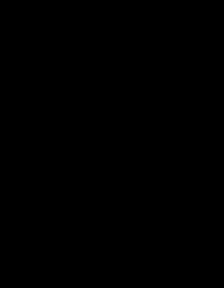

# `packs/mirage/`

**The game that uses the other two new abilities.** Spore Storm switches on
`splitOnHit`, `shield`, `teleport` and `spawnMinions`; this switches on the two it
left, `transform` and `mirrorPlayer`. Every alien in its formation carries exactly
one of them, and each is made legible on screen, so somebody watching can say what
each alien does without being told. `variants/mirage.json` names it, and the
start-up selector offers it as `MIRAGE`.

The abilities are engine behaviour (`src/sim/abilities/`); nothing here is code.
The pack switches them on and tunes them in its alien documents, says _where_ in a
dive the change happens with a `trigger` segment, and binds the one event the two
raise to a sound and an effect in `pack.json`, exactly as every other sound and
effect is bound.

## Why a game of its own, not more of Spore Storm

Spore Storm's claim is "one alien, one trick", four times, and it is measured: all
four tricks on stage 1 of every seed, from a formation whose four aliens are one per
ability. Adding two more would have meant a fifth and a sixth alien in the same
twenty-four slots — fewer of each, so each seen less often — and a game whose
point is that a watcher can name every trick would have six to name. It would also
have rewritten a measured, merged game's numbers to make room. A new pack leaves
Spore Storm exactly as it shipped and gives these two a formation to themselves,
at the cost of a fifth entry on the game list.

The two also belong together, which the other four would not: both are about an
alien that is **not what it was a moment ago** — one changes what it is, the other
changes where it is because of what you did. That is the mirage.

## What it is

An **overlay on Classic**, written the way `packs/spore-storm/` is:
self-contained, because `loadPack` resolves references within one pack, so its
stages name only its own aliens, paths and formation.

| It ships     | Count |
| ------------ | ----- |
| aliens       | 4     |
| flight paths | 7     |
| stages       | 3     |
| sprites      | 5     |
| sounds       | 1     |
| formations   | 1     |

<!-- check:count mirage.aliens 4 mirage.paths 7 mirage.stages 3 mirage.sprites 5 mirage.sounds 1 -->

Everything else it inherits: the whole of Classic's `rules.json`, the three enemy
roles, the stage badges, the jingles, the palette (every colour its sprites use is
one of Classic's, so it states none) and the challenge half of the stage sequence.
It states `stageSequence.normal` and leaves the challenge half empty, so stage 3 of
a Mirage run is Classic's `challenge-1`.
<!-- check:count mirage.palette 0 mirage.sequenceNormal 3 mirage.sequenceChallenge 0 -->

## One alien, one trick

Three aliens fill the formation, and a fourth is what one of them becomes. Three
carry an ability and the fourth carries none.
<!-- check:count mirage.abilityAliens 3 -->

| Alien     | Role   | Ability                    | What you see                                                                                                                                      |
| --------- | ------ | -------------------------- | ------------------------------------------------------------------------------------------------------------------------------------------------- |
| `shell`   | warden | `transform` into `stinger` | A sealed orange pod with a yellow seam. It never fires. Mid-dive it stops, hovers, cracks along the seam (`fx-molt`) and is a `stinger`           |
| `stinger` | warden | none                       | What hatches: narrow, red, striped, pointing down the screen. It fires two aimed shots, dives hard, and rejoins the formation in the shell's slot |
| `echo`    | drone  | `mirrorPlayer`, `track`    | The fighter's own outline, upside down and hollow. On a dive it slides wherever the fighter slid, a beat later                                    |
| `glass`   | wing   | `mirrorPlayer`, `opposite` | The fighter, upside down and filled violet, a glint running across it. On a dive it slides the other way to the fighter                           |

`enemy-morphed`, the one event the two abilities raise, is bound to `molt-crack` and
to `fx-molt`, and Classic binds it to neither, so the arcade game is unchanged by any
of this. `mirrorPlayer` raises no event — what it does is the diver's motion, so
that is what is tuned.
<!-- check:count mirage.boundSounds 1 mirage.boundEffects 1 -->

### Making a change of type readable

- **It changes where its path says, not on a clock.** `dive-molt` turns out of the
  formation, hovers, triggers the change, hovers again as the new alien, then
  lunges. A timed change lands anywhere in a dive and reads as a glitch; a pause
  either side reads as the alien doing it — the lesson of Spore Storm's blink.
  `afterFrames` is therefore unused.
- **The two aliens look nothing alike**, in shape as well as colour: a round pod,
  then a narrow wasp. A recolour would read as damage.
- **The change is the moment it becomes dangerous.** A shell fires nothing; a
  stinger fires two aimed shots and is worth 160 to the shell's 100, doubled on the
  dive as everything is. And because a stinger returns, the formation itself
  records each change: stingers sit in shells' slots for the rest of the stage.
- **The effect is the shell coming off**: the seam flashes white, the two halves fly
  apart and scatter. Sixteen steps, centred on the alien.
- **The sound rises.** `molt-crack` is a noise crack then a rising sweep.

### Not the arcade's transform attack

These rules also run Classic's own transform attack (`rules.transform`) from stage
4: once a stage, a settled drone — an `echo` here, or a `glass` when no echo is
home — pulses, then becomes three of Classic's aliens diving abreast. That is a
different thing that shares a word, and the game keeps the two apart on four
counts a player can see:

| This game's change                                                         | Classic's transform attack                                      |
| -------------------------------------------------------------------------- | --------------------------------------------------------------- |
| mid-dive, after a hover                                                    | in the formation, after a pulse                                 |
| one alien becomes one alien                                                | one alien becomes three                                         |
| only a `shell`, a warden, which the attack never picks                     | an `echo` or a `glass`: the attack's roles are drone, then wing |
| into a `stinger`, drawn here, with `molt-crack` and the shell flying apart | into Classic's own aliens, with Classic's dive sound            |

`tests/sim/mirage.test.ts` holds the first column to the rules: the changing alien's
role is one the attack never picks, what it becomes is none of the attack's types,
and the two events sound different. The attack itself is the coupling Spore Storm's
README records, and an overlay cannot switch it off.

### Making a mirror readable

The risk is real: a mirror that pulls weakly and late looks like a diver
drifting. Three choices keep the cause on screen:

- **Its own path has no sideways motion to hide behind.** `dive-shadow` and
  `dive-reflect` turn out of the formation and then fall straight down, slowly — so
  every pixel it moves sideways after that is the fighter's.
- **`strength` is 0.4**, for both: each frame it closes two-fifths of the gap to the
  column it copies, so it locks on within a handful of frames and then follows step
  for step. At 0.15 an echo moved with the fighter on 65% of the frames the fighter
  moved; at 0.4 it does on 87%, and a glass moves against it on 93%.
  <!-- check:count mirage.echoStrengthPercent 40 mirage.glassStrengthPercent 40 -->
- **The delays differ on purpose.** An `echo` copies the fighter as it stood twelve
  frames ago: without a delay, closing on your column is what an ordinary diver
  aiming at you does, and the beat behind is what says it is copying. A `glass`
  copies six frames ago, because moving _against_ you already says so, and a short
  delay makes the mirror look tight.
  <!-- check:count mirage.echoDelayFrames 12 mirage.glassDelayFrames 6 -->

The art says the rest: both are drawn from the fighter's own silhouette, upside
down. The `glass` is also hard to shoot by construction — its column is the
mirror of yours, so it is only above you near the middle of the screen — and it
drops its one straight shot where it is, which makes the middle the place it meets
you.

## The formation is twenty-four slots and ten columns

Six shells on top, eight glasses, then ten echoes — Spore Storm's geometry, which
the gate had already passed.
<!-- check:count mirage.formationSlots 24 mirage.formationColumns 10 mirage.formationRows 4 mirage.formationCaptiveSlots 0 -->

The rules layer couples it to numbers it cannot change, and it composes within
them (`docs/content-guide.md` section 7):

- **Ten columns, for the breathe table.** <!-- check:count rules.breatheColumns 10 -->
- **Classic's three role ids, for the launch rates.** A role the difficulty rows do
  not name never attacks. <!-- check:count rules.launchRoles 3 -->
- **A smaller fleet than the rules were written for.** Twenty-four slots under a
  continuous-bombing threshold set for forty.
- **No captive slots, so no tractor beam, on purpose.** A tractor beam is a third
  thing an alien does to the fighter, and this game is about two.

The pack manager reports both of the last two when this game's packs are mixed, and
`tests/sim/mirage.test.ts` holds the list to exactly those two. None of them
blocked the game this was meant to be; the transform attack above is the one that
shapes it, and it is composed around rather than worked around.

## What playing it measured

Headless, through the real simulation, flown by the variant's own personas at its
default rank. **On stage 1 alone, under `normal`** — the persona the attract demo
flies first — over twenty-four seeds:

| What            | Seen on stage 1 | Median first step |
| --------------- | --------------- | ----------------- |
| a shell changes | 24 of 24        | 884               |
| an echo copying | 24 of 24        | 840               |
| a glass copying | 24 of 24        | 882               |

So both abilities are on screen inside the first fifteen seconds of every stage 1.
`tests/sim/mirage.test.ts` holds all three to every seed of eight, and holds each
mirror to moving the way its mode says on more than four in five of the frames it
copies a move.

Whole games, twenty-four seeds, a three-minute limit:

| Persona     | Mean score | Median | Cleared stage 1 | Furthest stage |
| ----------- | ---------- | ------ | --------------- | -------------- |
| `normal`    | 4,450      | 3,270  | 9 of 24         | 5              |
| `astronaut` | 51,493     | 53,860 | 24 of 24        | 10             |

The same harness gives Classic 4,029 and 35,585, Deep Sea 4,079 and 33,409 and
Spore Storm 3,972 and 31,701. For `normal` this game sits with the others; the
`astronaut` scores more and reaches further: neither ability fires anything a
shell did not, and a stinger is worth 320 on the dive. In those twenty-four
astronaut games, 211 shells changed and Classic's attack ran 97 times — 87 times on
an echo, 10 on a glass, never on a shell or a stinger.
