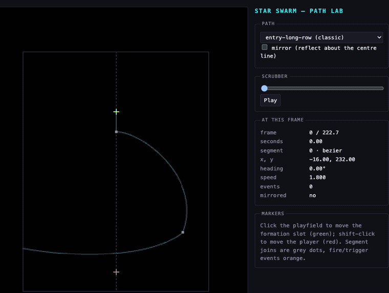

# `src/ui/lab/`

The `/lab` preview harness (`docs/DESIGN.md` section 8 step 3): one game's content,
a piece at a time, with no game started. Four views, over whichever game the page
is set to:

- **Paths** — every movement path, one drawn, with a scrubber, a readout of
  position, heading and speed at the frame, and a mirror toggle.
- **Aliens** — the alien's sprite and hit sprites frame by frame, every dive it
  can be launched on flown from a real formation slot of its role, its abilities,
  what the game's rules give its role, and the stages that send it.
- **Stages** — the stage run by the simulation with the controls untouched: the
  formation filling and each wave flying in, stepped a frame at a time either
  way, with the schedule, the events and the frame it settles.
- **Sounds** — every sound document, played on its own and drawn as the plan the
  synth builds for it, where the game plays it, and each audio theme auditioned
  event by event.

**Everything shown is read from the game.** `games.ts` loads the packs and the
variants through the loaders `src/main.ts` runs, so a preview is of one game's
composed registry — its packs in its own order, its rules, its stage sequence at
the chosen difficulty, its themes — and never of a pack on its own. Drawing,
flying, stepping and playing go through the renderer, the path interpreter, the
simulation and the synth the game uses. Where a preview meets a coupling the
rules layer cannot express, it says so in the pack manager's own words
(`findCouplings` and `couplingLines`).

- `main.ts` — the page: the game and difficulty, the four tabs, the keys, the way
  back, and the only file `lab.html` loads.
- `view.ts` — what a view is, and the DOM pieces the views share.
- `games.ts` — every game the build offers, loaded as the game loads them.
- `path-view.ts` and `path-preview.ts` — the path view, and drawing one path.
- `alien-view.ts` and `alien-facts.ts` — the alien view, and what it reads.
- `stage-view.ts` and `stage-run.ts` — the stage view, and the run it steps.
- `sound-view.ts`, `sound-facts.ts` and `sound-preview.ts` — the sound view, the
  bindings and themes it reads, and drawing one sound's plan.
- `capture.ts` — the page `npm run capture` drives, a separate entry
  (`capture.html`); see `docs/ARCHITECTURE.md` §4.3.

The facts modules and `stage-run.ts` touch no DOM, so the Node tests read them
directly: `tests/unit/lab-content.test.ts` holds the alien and sound facts to the
registry's documents and the rules' own resolvers, and
`tests/sim/lab-stages.test.ts` holds the stage run to the `stage-entry` golden,
bit for bit. `tests/e2e/lab.spec.ts` opens every view of every game in a browser.

## Keys

The game's own scheme: `ENTER` takes and `ESC` goes back. On a list, `U/D` moves
and the highlighted entry is shown; `ENTER` plays it from its start — a path from
frame 0, an alien's dive from its slot, a stage from its first step, a sound from
its first note. A link from one
view to another (an alien to its dive path, a stage to its alien, a theme to the
sound it swaps in) can be undone with `ESC`, which at the top does nothing. The
help box lists the keys from `LAB_KEYS` in `view.ts`.

Click the path view's playfield to move the formation slot, shift-click to move
the player; the slot is also where a dive path, which states no start, begins.
Click a slot in the alien view to fly its dives from there.

The address bar carries the game, the difficulty, the view and the item, so a link
opens the lab where it was made — and editing a pack document, which reloads the
page, comes back to the same item.

## Dev build only

`lab.html` at the repository root is the entry document, and Vite is never told
to build it — its only input is `index.html`, and nothing on that graph imports
this directory — so none of this reaches a production bundle or the game's code
path. `vite.config.ts` maps the `/lab` URL onto `lab.html` from a plugin
declaring `apply: 'serve'`. `tests/unit/lab-dev-only.test.ts` checks all of it.

Run it with `npm run dev` and open <http://localhost:5173/lab>.

`docs/media/path-lab.gif` is `entry-long-row` scrubbed end to end, then the same
data flown again with the mirror toggle on.
